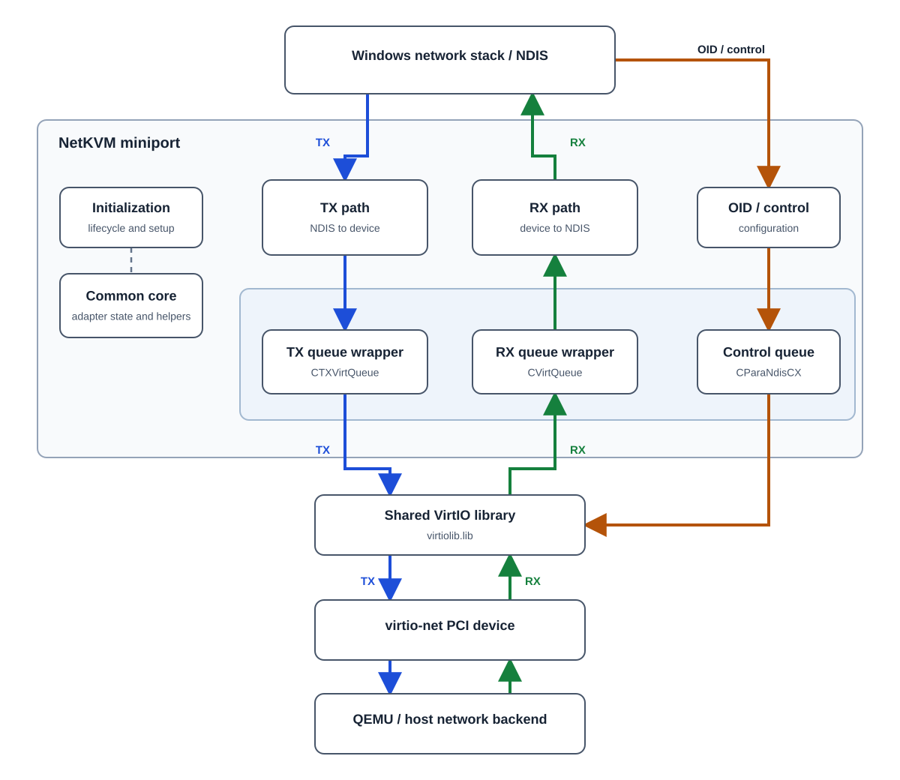
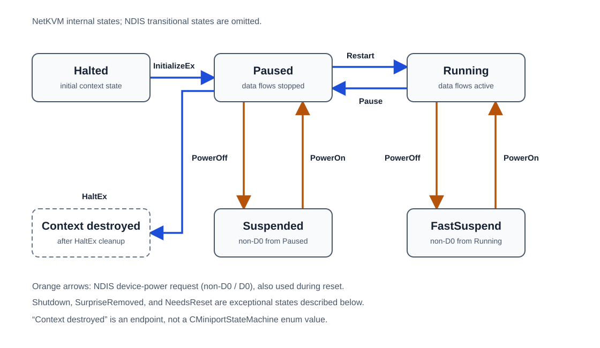

# NetKVM architecture

NetKVM is the Windows NDIS miniport for a virtio-net PCI device. Its main
responsibilities are to manage the adapter, exchange network packets with NDIS,
and access the device through VirtIO queues. The diagram below groups the code
by functional responsibility and marks the main TX and RX directions.

## Functional blocks

NDIS is above the RX/TX paths, with initialization and control beside
them. The VirtIO abstractions and shared library are below. Blue arrows show
TX toward the device; green arrows show RX toward NDIS. The dashed line
connects initialization to shared adapter state. The VirtIO library runs in
the Windows guest, while QEMU provides the device and network backend on the
host side.

| Block | Responsibility | Start reading |
| --- | --- | --- |
| Initialization and lifecycle | Register NDIS callbacks, create and stop the adapter, discover PCI resources, negotiate device features, and create queue pairs. | `DriverEntry` and `ParaNdis6_Initialize` in [ParaNdis6_Driver.cpp](../wlh/ParaNdis6_Driver.cpp); `ParaNdis_InitializeContext` and `ParaNdis_FinishInitialization` in [ParaNdis_Common.cpp](../Common/ParaNdis_Common.cpp) |
| Common core and adapter state | Hold shared configuration, device state, queue bundles, and helper routines used by other blocks. | `PARANDIS_ADAPTER` and `CPUPathBundle` in [ndis56common.h](../Common/ndis56common.h); `ParaNdis_DeviceEnterD0` in [ParaNdis_Common.cpp](../Common/ParaNdis_Common.cpp); `CNdisRWLock::Create` in [ParaNdis_Util.cpp](../Common/ParaNdis_Util.cpp) |
| RX path | Allocate and recycle receive buffers, process completed RX virtqueue entries, and indicate NBLs to NDIS. | `CParaNdisRX::ProcessRxRing` in [ParaNdis_RX.cpp](../Common/ParaNdis_RX.cpp); `ProcessReceiveQueue` in [ParaNdis_Common.cpp](../Common/ParaNdis_Common.cpp) |
| TX path | Accept NBLs from NDIS, map their buffers for DMA, submit them to a TX virtqueue, and complete sends. | `CParaNdisTX::Send` in [ParaNdis_TX.cpp](../Common/ParaNdis_TX.cpp); `CTXVirtQueue::SubmitPacket` in [ParaNdis_VirtQueue.cpp](../Common/ParaNdis_VirtQueue.cpp) |
| OID and control path | Handle NDIS configuration requests and send supported device commands through the optional control virtqueue. | `ParaNdis6_OidRequest` in [ParaNdis6_Oid.cpp](../wlh/ParaNdis6_Oid.cpp); `ParaNdis_OidQueryCommon` in [ParaNdis_Oid.cpp](../Common/ParaNdis_Oid.cpp); `CParaNdisCX::SendControlMessage` in [ParaNdis_CX.cpp](../Common/ParaNdis_CX.cpp) |
| Interrupts, DPC and polling | Handle device notifications and schedule RX/TX work through interrupt DPCs or NDIS polling. | `MiniportInterrupt` and `MiniportInterruptDPC` in [ParaNdis6_Impl.cpp](../wlh/ParaNdis6_Impl.cpp); `NdisPollHandler::Register` and `NdisPollHandler::HandlePoll` in [ParaNdis_Poll.cpp](../wlh/ParaNdis_Poll.cpp) |
| Feature modules | Implement capabilities that span other blocks, including RSS, offloads, and standby/failover. Availability depends on configuration and negotiated VirtIO features. | `InitRSSCapabilities` in [ParaNdis6_RSS.cpp](../wlh/ParaNdis6_RSS.cpp); `ParaNdis_CheckSumVerify` in [sw_offload.cpp](../Common/sw_offload.cpp); `ParaNdis_ProtocolInitialize` in [ParaNdis_Protocol.cpp](../Common/ParaNdis_Protocol.cpp) |
| VirtIO integration | Adapt NetKVM's RX, TX, and control paths to VirtIO queues and provide Windows-specific PCI, memory, and I/O callbacks to the shared library. | `CVirtQueue::Create` in [ParaNdis_VirtQueue.cpp](../Common/ParaNdis_VirtQueue.cpp); `ParaNdisSystemOps` in [ParaNdis_VirtIO.cpp](../Common/ParaNdis_VirtIO.cpp) |

## VirtIO library and host boundary

NetKVM links against the repository's shared `VirtIO/` library
(`virtiolib.lib`), as shown by the `virtiolib.lib` reference in [NetKVM-VS2015.vcxproj](../NetKVM-VS2015.vcxproj).
That library implements the virtio PCI transport and queue/ring operations;
NetKVM supplies Windows-specific callbacks through `ParaNdisSystemOps`.
The virtio-net device presented by QEMU is the boundary between the guest
driver and the host network backend. See
`virtio_device_initialize` in [VirtIOPCICommon.c](../../VirtIO/VirtIOPCICommon.c).

## Typical driver workflow

Windows [NDIS miniport operational states](https://learn.microsoft.com/en-us/windows-hardware/drivers/network/miniport-adapter-states-and-operations)
are `Halted`, `Initializing`, `Paused`, `Restarting`, `Running`, `Pausing`, and
`Shutdown`. The normal NDIS sequence is
`Halted → Initializing → Paused → Restarting → Running → Pausing → Paused`.
`MiniportHaltEx` returns the NDIS adapter from `Paused` to `Halted`.

The diagram below shows NetKVM's **internal**
`CMiniportStateMachine` in [ParaNdis-SM.h](../Common/ParaNdis-SM.h) for one adapter context.
It records the settled `Halted`, `Paused`, and `Running` states but not NDIS's
transitional `Initializing`, `Restarting`, or `Pausing` states. It also adds
power and exceptional states of its own. The final "Context destroyed" box is
an endpoint, not an enum value.

1. **Load and initialize.** `DriverEntry` registers the miniport callbacks.
   NDIS then calls `ParaNdis6_Initialize`, which creates `PARANDIS_ADAPTER`,
   reads PCI resources, negotiates VirtIO features, creates the queues, and
   prepares interrupts or polling. `NotifyInitialized` changes the new
   context from `Halted` to `Paused`. Configuration flows start here, while
   RX/TX data flows remain stopped.
2. **Run.** NDIS calls `ParaNdis6_Restart`; `NotifyRestarted` starts the data
   flows and changes `Paused` to `Running`. In this state, sends arrive as
   NBLs at `ParaNdis6_SendNetBufferLists`, while completed RX buffers are
   processed by a DPC or poll callback and indicated to NDIS. TX completions
   and returned RX NBLs release their outstanding work.
3. **Pause or stop.** `ParaNdis6_Pause` calls `NotifyPaused`, which stops the
   registered data flows and waits for outstanding items before changing
   `Running` to `Paused`. A later `Restart` returns to `Running`. On the usual
   removal path, `ParaNdis6_Halt` destroys the adapter context and releases
   queues and other resources. `NotifyHalted` stops configuration flows but
   does not set the internal state back to `Halted`.

| NetKVM internal state | NDIS operational state? | How it is entered |
| --- | --- | --- |
| `Halted` | Yes | Initial value when `PARANDIS_ADAPTER` constructs its state machine. |
| `Paused` | Yes | Successful initialization, NDIS Pause, or resume from `Suspended`. RX/TX data flows are stopped. |
| `Running` | Yes | NDIS Restart or resume from `FastSuspend`. RX/TX data flows are started. |
| `Suspended` | No | Device power-down from `Paused`. The adapter remembers that RX/TX were already stopped and returns to `Paused` on power-up. |
| `FastSuspend` | No | Device power-down from `Running`. RX/TX are stopped with `NDIS_STATUS_LOW_POWER_STATE`; power-up starts them again and returns directly to `Running`. |
| `Shutdown` | Yes | The adapter shutdown callback while `Paused` or `Running`. |
| `SurpriseRemoved` | No | A surprise-removal PnP event; the driver marks the device removed and resets the VirtIO device. |
| `NeedsReset` | No | A VirtIO `NEEDS_RESET` status event; the driver reports the condition to NDIS through CheckForHang. |

### Device power transitions

`Suspended` and `FastSuspend` are NetKVM states reached when NDIS asks for a
non-`D0` device-power state. If NDIS called Pause first, the OID enters `Suspended` and the driver
returns to `Paused` before NDIS Restart. If NDIS skips Pause, the OID enters
`FastSuspend` from `Running` and the driver restarts RX/TX itself on return to
`D0`. `D0` describes device power, not
whether RX/TX data flows are running. See
[NetKVM device power management](POWER_MANAGEMENT.md) for the `D1`/`D2`/`D3`
behavior, VirtIO teardown and restore, and the distinction from Windows Modern
Standby.

## Further reading

- [NetKVM programmer documentation](PROGRAMMER_DOCUMENTATION.md)
- [Initialization and VirtIO feature negotiation](INITIALIZATION.md)
- [NetKVM device power management](POWER_MANAGEMENT.md)
- [Driver configuration and failover](Readme.md)
- [Tracing](Tracing.md)

Each block above is a candidate for a dedicated deep-dive document. The
`NetKVM/Common/` directory contains code from several of these blocks; its
directory name does not define a single runtime layer.
