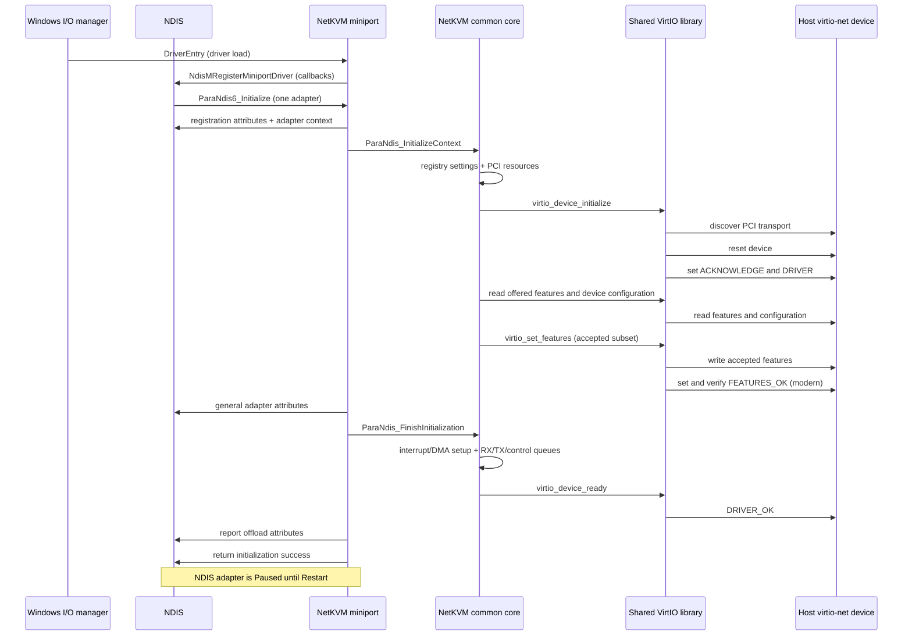

# NetKVM initialization and VirtIO feature negotiation

This document follows the initialization of one NetKVM adapter from the NDIS
callback to the first device-ready state. It is a code-reading guide: the
examples highlight decisions that affect the resulting adapter. Source links
name the relevant symbol beside the file link; they do not use line numbers.

The host presents a virtio-net PCI device (typically implemented by QEMU).
NetKVM does not call a QEMU API. It reads device features and configuration
through the shared VirtIO library and exchanges data through virtqueues.

## Two initialization scopes

`DriverEntry` runs once when Windows loads the driver. It registers NDIS
callbacks, reads driver-wide configuration, and initializes the optional
protocol component. `ParaNdis6_Initialize` runs for each adapter that NDIS
starts. The PCI discovery, feature negotiation, queue creation, and adapter
state transition described below belong to this second scope. See
`DriverEntry` and `ParaNdis6_Initialize` in [ParaNdis6_Driver.cpp](../wlh/ParaNdis6_Driver.cpp),
and `ParaNdis_ProtocolInitialize` in [ParaNdis_Protocol.cpp](../Common/ParaNdis_Protocol.cpp).



Read the diagram from top to bottom: each vertical participant is a component,
and each arrow shows an action initiated by the component on its left.
An arrow back to the same participant represents internal work. This is
the successful initialization path; return values, error branches, and
many lower-level calls are omitted. Arrows to the host device represent
VirtIO PCI/configuration/status operations, not direct QEMU API calls.

The order matters: the accepted feature set determines buffer layouts and
available queues. `DRIVER_OK` is a VirtIO device status bit; it is distinct
from the NDIS miniport's `Running` state. NDIS considers a successfully
initialized adapter `Paused` and later calls `Restart` to start its data
flows. See [NDIS adapter initialization](https://learn.microsoft.com/en-us/windows-hardware/drivers/network/initializing-a-miniport-adapter)
and the [VirtIO initialization sequence](https://docs.oasis-open.org/virtio/virtio/v1.3/virtio-v1.3.html).

## NDIS support versus VirtIO feature negotiation

A feature needs to pass several independent gates. Windows must provide the
required NDIS interface; the NetKVM binary must contain that code; local
configuration must permit it; and, for device-backed features, the host must
offer the required VirtIO bits. NetKVM then selects a subset of the offered
bits and reports the resulting capability to NDIS. An NDIS version is therefore
an *eligibility threshold*, not a promise that a feature is active.

| Capability | Windows / NDIS gate | NetKVM build and local gate | Host VirtIO gate | Result during initialization |
| --- | --- | --- | --- | --- |
| RSS and multiple RX/TX queues | RSS code starts at NDIS 6.20; NDIS 6.80 adds UDP hash capability reporting. | `PARANDIS_SUPPORT_RSS`; `*RSS`, queue count, CPUs, and MSI-X affect usable queues. | Multiple queue pairs need `CTRL_VQ` plus `MQ`, or validated device `RSS` on a modern device. `HASH_REPORT` is optional for device-supplied hashes. | Reports RSS capabilities and chooses the queue count that can actually be created. Device RSS and guest-side RSS are distinct paths. See `ParaNdis_InitializeContext` in [ParaNdis_Common.cpp](../Common/ParaNdis_Common.cpp) and `InitRSSCapabilities` in [ParaNdis6_RSS.cpp](../wlh/ParaNdis6_RSS.cpp). |
| Receive segment coalescing (RSC) | NDIS 6.30. | `PARANDIS_SUPPORT_RSC` and local RSC settings. | `GUEST_CSUM` and the relevant `GUEST_TSO4` / `GUEST_TSO6` offer gate IPv4 / IPv6 support. `CTRL_VQ` plus `CTRL_GUEST_OFFLOADS` permit dynamic configuration; `RSC_EXT` is an additional device extension. | Initializes the RSC state and reports supported/default offloads. See `InitializeRSCState` in [ParaNdis_Common.cpp](../Common/ParaNdis_Common.cpp). |
| UDP segmentation offload (USO) | NDIS 6.83; NDIS 6.84 adds the `SubMssFinalSegmentSupported` field. | `PARANDIS_SUPPORT_USO` and configured `*UsoIPv4` / `*UsoIPv6`. | Requires accepted `HOST_USO`; accepted `STANDBY` disables this path. | Clears unsupported USO settings or reports them through the appropriate `NDIS_OFFLOAD` revision. See `ParaNdis_InitializeContext` in [ParaNdis_Common.cpp](../Common/ParaNdis_Common.cpp) and `FillOffloadStructure` in [ParaNdis6_Oid.cpp](../wlh/ParaNdis6_Oid.cpp). |
| TX checksum and large send offload (LSO) | Available in the NDIS 6.x offload interface; no new 6.83 gate. | Local checksum/LSO settings must request them. | TX checksum needs `CSUM`; LSO v4/v6 additionally needs `HOST_TSO4` / `HOST_TSO6`. | Removes unsupported options before reporting offload attributes. See `ParaNdis_InitializeContext` in [ParaNdis_Common.cpp](../Common/ParaNdis_Common.cpp). |
| NDIS poll mode | This implementation compiles poll code with NDIS 6.86, but currently attempts it only when **OS NDIS is at least 6.89**. | `PARANDIS_SUPPORT_POLL`, `*NdisPoll=1`, suitable RSS queues, and successful poll-handler registration. | No dedicated VirtIO poll feature; accepted `STANDBY` suppresses the attempt. | Enables `bPollModeEnabled` only if all required handlers register. See `ParaNdis_FinishInitialization` in [ParaNdis_Common.cpp](../Common/ParaNdis_Common.cpp) and `NdisPollHandler::Register` in [ParaNdis_Poll.cpp](../wlh/ParaNdis_Poll.cpp). |

Some version differences affect the NDIS contract without requiring any
VirtIO feature. `NDIS_SUPPORT_NDIS61` adds direct OID callbacks;
`NDIS_SUPPORT_NDIS620` selects the newer general attributes and power
capabilities; `NDIS_SUPPORT_NDIS630` adds `NO_PAUSE_ON_SUSPEND`;
`NDIS_SUPPORT_NDIS650` enables runtime version detection and the v3 HAL DMA
flag; and NDIS 6.80 selects newer miniport/RSS structure revisions at runtime.
The `NDIS_OFFLOAD` structure changes to revision 6 at NDIS 6.83 and revision 7
at 6.85. See `DriverEntry` in [ParaNdis6_Driver.cpp](../wlh/ParaNdis6_Driver.cpp),
`ParaNdis_FinishSpecificInitialization` in [ParaNdis6_Impl.cpp](../wlh/ParaNdis6_Impl.cpp),
and `FillOffloadStructure` in [ParaNdis6_Oid.cpp](../wlh/ParaNdis6_Oid.cpp).

The project builds `Win10 Release` with `NDIS685_MINIPORT=1` and `Win11 Release`
with `NDIS686_MINIPORT=1`. `SetRuntimeNdisVersion` uses `NdisGetVersion` to
select the effective NDIS version; `CheckNdisVersion` tests that value, whereas
`CheckOSNdisVersion` tests the OS version. There is a special case that lets
the 6.86 build report effective NDIS 6.89 on an OS with NDIS 6.89. See
[NetKVM-VS2015.vcxproj](../NetKVM-VS2015.vcxproj),
`SetRuntimeNdisVersion` in [ParaNdis6_Driver.cpp](../wlh/ParaNdis6_Driver.cpp),
`CheckNdisVersion` and `CheckOSNdisVersion` in [ndis56common.h](../Common/ndis56common.h), and Microsoft's
[OS-to-NDIS version table](https://learn.microsoft.com/en-us/windows-hardware/drivers/network/overview-of-ndis-versions).

## Phase 1: register the driver and create an adapter

`DriverEntry` fills `NDIS_MINIPORT_DRIVER_CHARACTERISTICS`. Its callbacks
include initialize, halt, pause, restart, OID handling, send, return, reset,
and PnP. It then calls `NdisMRegisterMiniportDriver`. The adapter does not yet
exist at this point. See `DriverEntry` in [ParaNdis6_Driver.cpp](../wlh/ParaNdis6_Driver.cpp).

### Registered NDIS callbacks

`DriverEntry` assigns these handlers to `NDIS_MINIPORT_DRIVER_CHARACTERISTICS`
before calling `NdisMRegisterMiniportDriver`:

| Callback field | NetKVM function | Source file | Responsibility |
| --- | --- | --- | --- |
| `InitializeHandlerEx` | `ParaNdis6_Initialize` | [ParaNdis6_Driver.cpp](../wlh/ParaNdis6_Driver.cpp) | Initialize one adapter. |
| `HaltHandlerEx` | `ParaNdis6_Halt` | [ParaNdis6_Driver.cpp](../wlh/ParaNdis6_Driver.cpp) | Release one adapter. |
| `UnloadHandler` | `ParaNdis6_Unload` | [ParaNdis6_Driver.cpp](../wlh/ParaNdis6_Driver.cpp) | Unload the driver. |
| `PauseHandler` | `ParaNdis6_Pause` | [ParaNdis6_Driver.cpp](../wlh/ParaNdis6_Driver.cpp) | Stop adapter data flows. |
| `RestartHandler` | `ParaNdis6_Restart` | [ParaNdis6_Driver.cpp](../wlh/ParaNdis6_Driver.cpp) | Start adapter data flows. |
| `OidRequestHandler` | `ParaNdis6_OidRequest` | [ParaNdis6_Oid.cpp](../wlh/ParaNdis6_Oid.cpp) | Process an ordinary OID request. |
| `CancelOidRequestHandler` | `ParaNdis6_OidCancelRequest` | [ParaNdis6_Oid.cpp](../wlh/ParaNdis6_Oid.cpp) | Cancel an OID request. |
| `SendNetBufferListsHandler` | `ParaNdis6_SendNetBufferLists` | [ParaNdis6_Driver.cpp](../wlh/ParaNdis6_Driver.cpp) | Accept outgoing NBLs. |
| `CancelSendHandler` | `ParaNdis6_CancelSendNetBufferLists` | [ParaNdis6_Impl.cpp](../wlh/ParaNdis6_Impl.cpp) | Cancel queued sends. |
| `ReturnNetBufferListsHandler` | `ParaNdis6_ReturnNetBufferLists` | [ParaNdis6_Driver.cpp](../wlh/ParaNdis6_Driver.cpp) | Reclaim returned receive NBLs. |
| `CheckForHangHandlerEx` | `ParaNdis6_CheckForHang` | [ParaNdis6_Driver.cpp](../wlh/ParaNdis6_Driver.cpp) | Check adapter progress and reset needs. |
| `ResetHandlerEx` | `ParaNdis6_Reset` | [ParaNdis6_Driver.cpp](../wlh/ParaNdis6_Driver.cpp) | Reset the adapter. |
| `ShutdownHandlerEx` | `ParaNdis6_AdapterShutdown` | [ParaNdis6_Driver.cpp](../wlh/ParaNdis6_Driver.cpp) | Handle system shutdown. |
| `DevicePnPEventNotifyHandler` | `ParaNdis6_DevicePnPEvent` | [ParaNdis6_Driver.cpp](../wlh/ParaNdis6_Driver.cpp) | Handle adapter PnP notifications. |
| `SetOptionsHandler` | `ParaNdis6_SetOptions` | [ParaNdis6_Driver.cpp](../wlh/ParaNdis6_Driver.cpp) | Register additional PnP handlers. |

When compiled with `NDIS_SUPPORT_NDIS61`, it also assigns
`DirectOidRequestHandler` to `ParaNdis6x_DirectOidRequest` and
`CancelDirectOidRequestHandler` to `ParaNdis6x_CancelDirectOidRequest`
in [ParaNdis6_Driver.cpp](../wlh/ParaNdis6_Driver.cpp).
The `NDIS_SUPPORT_NDIS680` branch changes the characteristics structure's
revision for NDIS 6.80 or later; it does not add another callback here.

`ParaNdis6_SetOptions` registers four optional PnP callbacks through
`NdisSetOptionalHandlers` using `NDIS_MINIPORT_PNP_CHARACTERISTICS`:

- **Callback:** `MiniportAddDeviceHandler`\
  **Function:** `ParaNdis6_AddDevice` in [ParaNdis6_Driver.cpp](../wlh/ParaNdis6_Driver.cpp).\
  **Behavior:** Registers `MiniportAdapterHandle` as `MiniportAddDeviceContext` through
  `NdisMSetMiniportAttributes`. The later resource-filter callback uses this
  handle; `PARANDIS_ADAPTER` is not created here.

- **Callback:** `MiniportRemoveDeviceHandler`\
  **Function:** `ParaNdis6_RemoveDevice` in [ParaNdis6_Driver.cpp](../wlh/ParaNdis6_Driver.cpp).\
  **Behavior:** Only logs entry. It has no device-specific resources to release; adapter
  cleanup happens in `ParaNdis6_Halt`.

- **Callback:** `MiniportStartDeviceHandler`\
  **Function:** `ParaNdis6_StartDevice` in [ParaNdis6_Driver.cpp](../wlh/ParaNdis6_Driver.cpp).\
  **Behavior:** Returns `NDIS_STATUS_SUCCESS` without examining the IRP. Adapter
  initialization happens later in `ParaNdis6_Initialize`.

- **Callback:** `MiniportFilterResourceRequirementsHandler`\
  **Function:** `ParaNdis6_FilterResource` in [ParaNdis6_Driver.cpp](../wlh/ParaNdis6_Driver.cpp).\
  **Behavior:** Uses `ParseFilterResourceIrp` to rebuild the IRP's resource-requirements
  list. When driver-wide `DisableMSI` is set, it removes message-interrupt
  descriptors and clears the alternative flag on line interrupts. Otherwise,
  it keeps the descriptors and `SetupInterrruptAffinity` assigns processor
  affinity to message interrupts. Alternatives left without an interrupt are
  discarded. If allocation succeeds, it replaces the IRP's list and frees
  the old one; if allocation fails, the original list stays in place.
  `RetrieveDriverConfiguration` reads `DisableMSI`.

When NDIS calls `ParaNdis6_Initialize`, the function constructs one
`PARANDIS_ADAPTER` and immediately supplies its context and registration
flags to NDIS. It then calls `ParaNdis_InitializeContext` to begin local
configuration, PCI discovery, and VirtIO feature negotiation. At this point
it has not yet reported offload capabilities. See `ParaNdis6_Initialize` in [ParaNdis6_Driver.cpp](../wlh/ParaNdis6_Driver.cpp)
and `CMiniportStateMachine` in [ParaNdis-SM.h](../Common/ParaNdis-SM.h).

The adapter context is the main object to follow while reading the code:

| Field or group in `PARANDIS_ADAPTER` | Role during initialization |
| --- | --- |
| `MiniportHandle`, `PciResources`, `IODevice` | NDIS adapter handle, mapped PCI resources, and VirtIO transport state. |
| `u64HostFeatures`, `u64GuestFeatures` | Offered device feature bits and the subset selected by NetKVM. |
| `bControlQueueSupported`, `bMultiQueue`, `bUseMergedBuffers`, `bUsingMSIX` | Decisions that determine available commands, queue topology, receive layout, and interrupt handling. |
| `nHardwareQueues`, `nPathBundles`, `pPathBundles`, `CXPath` | Device-reported pair limit, active RX/TX pair count, allocated pairs, and optional control path. |
| `MaxPacketSize`, `RxLayout`, `nVirtioHeaderSize`, `Offload`, `RSC` | Packet and buffer layout plus negotiated and configured offload behavior. |
| `m_StateMachine`, `m_RxStateMachine`, `m_CxStateMachine` | Adapter and flow lifecycle after initialization. |

See `PARANDIS_ADAPTER` in [ndis56common.h](../Common/ndis56common.h).

## Phase 2: local configuration and PCI resources

`ReadNicConfiguration` starts from `defaultConfiguration`, reads adapter
registry values through NDIS, and writes effective local preferences into
`PARANDIS_ADAPTER`. Examples include `TxCapacity`, `RxCapacity`,
`MergeableBuffers`, `*RSS`, `*NumRssQueues`, offload settings, and `*NdisPoll`.
`GetConfigurationEntry` accepts an override only when it is within the
entry's configured range. These registry values express local policy; they
are not device features and do not by themselves enable VirtIO capabilities.
See `ReadNicConfiguration` and `GetConfigurationEntry` in
[ParaNdis_Common.cpp](../Common/ParaNdis_Common.cpp).

`CPciResources::Init` reads PCI configuration space, associates assigned
port/memory resources with BAR indices, and records the interrupt resource.
It fails if the resource list is missing, PCI configuration cannot be read,
or a usable BAR/interrupt is not found. The interrupt flags select MSI-X or
shared-vector handling before VirtIO transport initialization. See
`CPciResources::Init` in [ParaNdis_VirtIO.cpp](../Common/ParaNdis_VirtIO.cpp) and
`CPciResources` in [ParaNdis-VirtIO.h](../Common/ParaNdis-VirtIO.h).

## Phase 3: open and reset the VirtIO transport

`ParaNdis_InitializeContext` passes `IODevice`, `ParaNdisSystemOps`, the
adapter context, and the MSI-X choice to `virtio_device_initialize`.
`ParaNdisSystemOps` supplies Windows-specific PCI access, register I/O,
memory allocation, physical-address lookup, MSI-X lookup, and sleep callbacks
to the shared library. See `ParaNdisSystemOps` in [ParaNdis_VirtIO.cpp](../Common/ParaNdis_VirtIO.cpp).

The shared library tries the modern PCI transport first. It falls back to
legacy transport when modern discovery returns `STATUS_DEVICE_NOT_CONNECTED`.
On success it resets the device, then sets VirtIO `ACKNOWLEDGE` and `DRIVER`
status bits. These are VirtIO status bits, separate from NDIS states. See
`virtio_device_initialize` in [VirtIOPCICommon.c](../../VirtIO/VirtIOPCICommon.c),
`vio_modern_initialize` in [VirtIOPCIModern.c](../../VirtIO/VirtIOPCIModern.c), and
`vio_legacy_initialize` in [VirtIOPCILegacy.c](../../VirtIO/VirtIOPCILegacy.c).

## Phase 4: read the device offer and select features

The device advertises a 64-bit feature bitmap. NetKVM stores it in
`u64HostFeatures`; `u64GuestFeatures` starts at zero and accumulates selected
bits. `AckFeature` is the small but important gate:

```cpp
static BOOLEAN AckFeature(PPARANDIS_ADAPTER pContext, UINT64 Feature)
{
    if (virtio_is_feature_enabled(pContext->u64HostFeatures, Feature))
    {
        virtio_feature_enable(pContext->u64GuestFeatures, Feature);
        return TRUE;
    }
    return FALSE;
}
```

The names `HostFeatures` and `GuestFeatures` are the driver's names for the
device offer and driver-selected subset. An effective capability can also
depend on registry settings, compiled-in support, OS/NDIS version, and other
feature bits. `AckFeature` checks only whether a bit was offered; each caller
must enforce any additional local or protocol dependency before calling it.
After selection,
`virtio_set_features(IODevice, u64GuestFeatures)` writes the subset to the
device. For a modern (`VIRTIO_F_VERSION_1`) device, the shared library sets
`FEATURES_OK` and checks whether the device kept that bit. A refusal causes
initialization to fail. See `AckFeature` and `ParaNdis_InitializeContext` in
[ParaNdis_Common.cpp](../Common/ParaNdis_Common.cpp),
`virtio_set_features` in [VirtIOPCICommon.c](../../VirtIO/VirtIOPCICommon.c),
and `VIRTIO_NET_F_STATUS` and `VIRTIO_NET_F_CTRL_VQ` in
[virtio_net.h](../Common/virtio_net.h).

### Important feature dependencies in this implementation

| Capability | Conditions in NetKVM | Result |
| --- | --- | --- |
| Link status and guest announce | `STATUS` enables reading link status; guest announce additionally requires `CTRL_VQ` and `GUEST_ANNOUNCE`. | Link state and announce handling become available only for the accepted combination. |
| Control commands | `CTRL_VQ` must be offered. `CTRL_RX`, `CTRL_RX_EXTRA`, `CTRL_VLAN`, and `CTRL_MAC_ADDR` are selected only inside that branch. | RX filter, VLAN, and MAC control commands depend on the control queue. |
| Mergeable RX buffers | Local `MergeableBuffers` must be nonzero and the device must offer `MRG_RXBUF`. | Selects the mergeable header/layout; otherwise the feature is left unacknowledged. |
| Multiqueue | `CTRL_VQ` and `MQ` must be offered for `bMultiQueue` through the MQ path. Device RSS can also set `bMultiQueue` after RSS capability checks. | Allows more than one RX/TX pair, subject to CPU and interrupt limits. |
| Device RSS/hash | Requires a control queue, modern device (`VERSION_1`), device offer of `RSS` or `HASH_REPORT`, and capability validation. | Stores device RSS limits and may accept `RSS` and/or `HASH_REPORT`. |
| TX checksum and LSO | Configured TCP/UDP TX checksum options are gated by device `CSUM`; TX LSO v4/v6 additionally tests `HOST_TSO4`/`HOST_TSO6`. | Unsupported offload settings are removed from the effective configuration. |
| RX checksum and RSC | `GUEST_CSUM` is accepted when offered; RSC setup exits early without it. Dynamic RSC additionally needs `CTRL_VQ` and `CTRL_GUEST_OFFLOADS`. | Determines receive checksum/RSC support and later control commands. |
| Packed ring | `RING_PACKED` is selected only in the `VERSION_1` branch. | Changes VirtIO ring format if offered and accepted. |
| Ring helpers | `EVENT_IDX` and `INDIRECT_DESC` are selected when offered; `ANY_LAYOUT` is selected when offered, and assumed for a v1 device. | Controls notification and descriptor/buffer layout choices. |
| TX USO | Configured USO requires NDIS 6.83 or newer, no accepted `STANDBY`, and device `HOST_USO`. | Otherwise the configured USO bits are cleared. |
| Standby/failover | `STANDBY` is selected when offered. | Suppresses initial link-up and disables the attempt to use NDIS poll mode. |

This table describes code paths, not a complete list of VirtIO requirements.
Read `ParaNdis_InitializeContext` in [ParaNdis_Common.cpp](../Common/ParaNdis_Common.cpp),
`ParaNdis6_CheckDeviceRSSCapabilities` in [ParaNdis6_RSS.cpp](../wlh/ParaNdis6_RSS.cpp),
and the
[VirtIO specification](https://docs.oasis-open.org/virtio/virtio/v1.3/virtio-v1.3.html)
for the protocol rules.

Three useful combinations to trace in the code:

1. Device offers `MRG_RXBUF`, but registry `MergeableBuffers=0`: NetKVM does
   not select `MRG_RXBUF` and starts with the non-mergeable header size.
2. Device offers `MQ`, but not `CTRL_VQ`: the MQ branch leaves
   `bMultiQueue` false. One hardware pair is used unless another supported
   path changes that decision.
3. Device offers `RSS`, but not `VERSION_1`: the device RSS capability branch
   is skipped, so NetKVM does not select `RSS` there.

### Device configuration fields

The feature bits say *which* fields or commands are available; the
`virtio_net_config` structure carries values. NetKVM reads `status` if
`STATUS` was selected, MAC if `MAC` was selected, `mtu` if `MTU` was selected,
and speed/duplex if `SPEED_DUPLEX` was selected. It reads
`max_virtqueue_pairs` when multiqueue is enabled, and RSS limits after the
RSS/hash prerequisites are met. MAC handling validates the device address,
provides a fallback address when necessary, and considers a configured
address only where the transport can apply it. See
`virtio_net_config` definition in [virtio_net.h](../Common/virtio_net.h) and
`InitializeMaxMTUConfig` and `InitializeLinkPropertiesConfig` in
[ParaNdis_Common.cpp](../Common/ParaNdis_Common.cpp).

## Phase 5: allocate NDIS resources and VirtIO queues

After `ParaNdis_InitializeContext` returns, the NDIS callback reports
general adapter attributes. `ParaNdis_FinishInitialization` then calls the
NDIS-specific setup to allocate the NBL pool, register interrupts, and
register scatter/gather DMA. Only after that does it reserve VirtIO queue
memory and create RX/TX paths. See `ParaNdis_FinishSpecificInitialization` in
[ParaNdis6_Impl.cpp](../wlh/ParaNdis6_Impl.cpp) and `ParaNdis_VirtIONetInit` in
[ParaNdis_Common.cpp](../Common/ParaNdis_Common.cpp).

### When NDIS learns the adapter capabilities

`ParaNdis6_Initialize` calls `NdisMSetMiniportAttributes` at three different
points. The first call happens before VirtIO negotiation; the later calls
use information gathered during initialization:

| NDIS attribute type | When it is reported | Information available at that point |
| --- | --- | --- |
| Registration | Immediately after creating `PARANDIS_ADAPTER`. | Adapter context, PCI interface type, registration flags, and hang-check interval. No negotiated offload capabilities. |
| General | After `ParaNdis_InitializeContext` has read device features/configuration and selected its feature subset. | MTU, MAC addresses, link properties, supported OIDs, and RSS information derived from the effective adapter state. |
| Offload | After `ParaNdis_FinishInitialization`. | `HardwareOffloadCapabilities` and `DefaultOffloadConfiguration`, prepared from local settings, negotiated device features, and the applicable NDIS version. |

The offload report is therefore not a copy of QEMU's feature bitmap.
`ReadNicConfiguration` sets local offload preferences; feature negotiation
removes or enables options according to the device offer; and
`ParaNdis6_ApplyOffloadPersistentConfiguration` builds the initial NDIS
offload structures during the NDIS-specific part of
`ParaNdis_FinishInitialization`. Finally,
`ParaNdis6_GetRegistrationOffloadInfo` passes pointers to
`ReportedOffloadCapabilities` and `ReportedOffloadConfiguration` to NDIS.
See `ParaNdis6_Initialize` in [ParaNdis6_Driver.cpp](../wlh/ParaNdis6_Driver.cpp),
`ParaNdis_InitializeContext` in [ParaNdis_Common.cpp](../Common/ParaNdis_Common.cpp),
`ParaNdis_FinishSpecificInitialization` in [ParaNdis6_Impl.cpp](../wlh/ParaNdis6_Impl.cpp),
and `ParaNdis6_GetRegistrationOffloadInfo` in [ParaNdis6_Oid.cpp](../wlh/ParaNdis6_Oid.cpp).

`nHardwareQueues` is the device-reported maximum number of RX/TX pairs (or
one when multiqueue is unavailable). `nPathBundles` is the number this driver
actually creates. Without MSI-X it uses one pair. With MSI-X and multiqueue,
`DetermineQueueNumber` limits the count by the device's pair limit, CPU
count, and available message vectors; one- or two-message cases fall back
to one pair. The code reserves memory for `2 * nHardwareQueues + 2`
virtqueues. For bundle `i`, RX uses index `2*i` and TX uses `2*i+1`; the
optional control path uses `2*nHardwareQueues`. See
`DetermineQueueNumber` and `ParaNdis_VirtIONetInit` in
[ParaNdis_Common.cpp](../Common/ParaNdis_Common.cpp),
`CParaNdisRX::Create` in [ParaNdis_RX.cpp](../Common/ParaNdis_RX.cpp),
`CParaNdisTX::Create` in [ParaNdis_TX.cpp](../Common/ParaNdis_TX.cpp), and
`CParaNdisCX::Create` in [ParaNdis_CX.cpp](../Common/ParaNdis_CX.cpp).

If a control queue was advertised but creating `CXPath` fails, the code
marks `bCXPathCreated` false and disables the corresponding control-command
flags. This case deserves a separate review before treating every advertised
control feature as operational.

The remaining setup assigns MSI-X vectors, DPC targets, and optional NDIS
poll handlers. `ParaNdis_DeviceEnterD0` reads link state, sets VirtIO
`DRIVER_OK`, configures multiqueue/RSC and MAC as applicable, and kicks RX
queues. The NDIS callback subsequently reports offload attributes, calls
`NotifyInitialized`, and returns success. Data flow starts on NDIS
`Restart`, as described in the [architecture workflow](ARCHITECTURE.md).
See `ParaNdis_DeviceEnterD0` in [ParaNdis_Common.cpp](../Common/ParaNdis_Common.cpp)
and `ParaNdis6_Initialize` in [ParaNdis6_Driver.cpp](../wlh/ParaNdis6_Driver.cpp).

## Failure path and review checkpoints

At each stage a resource or feature error can stop initialization. The
NDIS callback destroys the partially created adapter on failure and
unregisters the optional protocol adapter. The shared VirtIO library
rejects a modern feature set if `FEATURES_OK` is not retained. See
`ParaNdis6_Initialize` in [ParaNdis6_Driver.cpp](../wlh/ParaNdis6_Driver.cpp)
and `virtio_set_features` in [VirtIOPCICommon.c](../../VirtIO/VirtIOPCICommon.c).

Questions for the next code-reading pass:

1. Which registry values should be documented as public configuration, and
   which are implementation details? Trace `defaultConfiguration` into
   `ReadNicConfiguration` and the INF defaults.
2. What happens if the control virtqueue cannot be created after its feature
   was accepted? Trace `bCXPathCreated`, `bControlQueueSupported`, and
   `bMultiQueue` through queue setup and `ParaNdis_DeviceEnterD0`.
3. Which initial device configuration writes occur on legacy transport
   versus modern transport? Trace `InitializeMAC`, `SetDeviceMAC`, and
   `ParaNdis_UpdateMAC`.
4. How are queue-pair and offload configuration failures reported during
   `ParaNdis_DeviceEnterD0`? Trace the return values of its control
   commands and the final NDIS initialization status.

These questions are intentionally left as review points; the preceding
sections document paths checked directly against this source tree.
