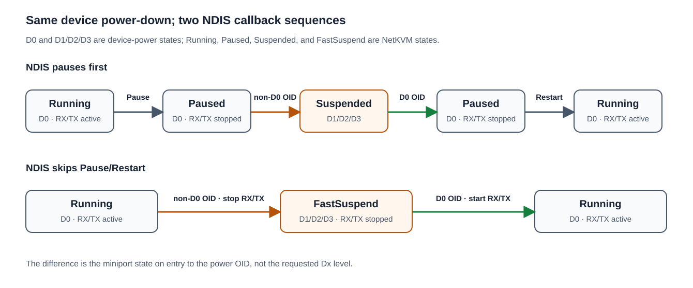

# NetKVM device power management

This page describes how NetKVM handles NDIS device-power requests and how its
internal `Suspended` and `FastSuspend` states relate to those requests. It also
explains Windows Modern Standby as context. The [architecture overview](ARCHITECTURE.md)
shows the full adapter lifecycle; this page follows only the power path.

## Windows device power states

Windows uses four network-device power states. They describe the **device's
power and ability to operate**, not whether the NDIS miniport is `Running`.
The details below summarize [Microsoft's device-power state reference](https://learn.microsoft.com/en-us/windows-hardware/drivers/network/device-power-states-for-network-adapters).

- **D0 — fully powered.** The
  adapter provides its normal network functions. Its NDIS miniport can still
  be `Paused`.
- **D1 — lightest sleep.** The
  adapter uses less power than in `D0`. Normal packet traffic stops; the
  driver preserves device context that may be lost and restores it on return
  to `D0`.
- **D2 — intermediate sleep.**
  The adapter generally uses less power than in `D1` and takes longer to
  restore to `D0`. Its network-driver behavior is otherwise the same as `D1`.
- **D3 — deepest device sleep.**
  `D3hot` can retain some power; `D3cold` may remove it entirely. They are
  hardware/bus distinctions within `D3`, not extra values in NetKVM's
  `OID_PNP_SET_POWER` request. The driver must not access the device after
  the bus has placed it in `D3`.

NDIS can request a change from `D0` to one low-power `Dx` state, or back
to `D0`, but not directly between `D1`, `D2`, and `D3`.

> *Note: Windows system states (for example `S0`, traditional sleep, and
> hibernation) are a separate layer. Modern Standby is an `S0 Low Power Idle`
> system model, explained [below](#modern-standby-windows-context); none of
> these names is a NetKVM miniport state.*

## How NetKVM handles these states

NetKVM receives `OID_PNP_SET_POWER` with an `NDIS_DEVICE_POWER_STATE` value.
Its `OnSetPowerWorkItem` distinguishes only `D0` from non-`D0` values. It does
not retain the exact `D1`, `D2`, or `D3` value in its internal
`CMiniportStateMachine`. See `ParaNdis_OnSetPower` and `OnSetPowerWorkItem` in
[ParaNdis6_Oid.cpp](../wlh/ParaNdis6_Oid.cpp).

| Requested device state | NetKVM handling |
| --- | --- |
| [D0](#device-d0) | `ParaNdis_PowerOn` restores VirtIO, renews queues, refills RX, then restores the prior miniport state. |
| [D1](#device-d1) | `ParaNdis_PowerOff` stops the device and queues. |
| [D2](#device-d2) | Same `ParaNdis_PowerOff` path as `D1`. |
| [D3](#device-d3) | Same `ParaNdis_PowerOff` path as `D1`; NetKVM has no separate `D3hot`/`D3cold` branch here. |

The miniport state is a second dimension: `CMiniportStateMachine` remembers
whether RX/TX were already stopped (`Paused → Suspended`) or were active
(`Running → FastSuspend`). It restores the corresponding state when the
device returns to `D0`. See `CMiniportStateMachine::NotifySuspended` and
`CMiniportStateMachine::NotifyResumed` in
[ParaNdis-SM.h](../Common/ParaNdis-SM.h).

> *Note: A VM pause, host-side live migration, Windows sleep, and a
> device-power OID are different events. The path below starts when NDIS
> delivers a device-power OID to NetKVM; not every VM power event produces one.*

## Why two suspend states?

**Both states use the same VirtIO power-down procedure and can represent any
of `D1`, `D2`, or `D3`.** The difference is whether NDIS paused the miniport
*before* sending the power OID:

- **With NDIS Pause:** `Running → Paused → Suspended → Paused → Running`.
  NDIS calls `MiniportPause` first. The power OID arrives while RX/TX are
  already stopped, so NetKVM records `Suspended`. On return to `D0`, it
  restores `Paused`; a later NDIS `MiniportRestart` starts RX/TX.
- **Without NDIS Pause:** `Running → FastSuspend → Running`.
  The power OID arrives while RX/TX are active. NetKVM stops the flows itself
  and records `FastSuspend`. On return to `D0`, NetKVM starts them itself;
  there is no NDIS Pause/Restart pair around that transition.

`Fast` therefore refers to the **NDIS path that skips Pause/Restart**, not a
lighter sleep state, faster VirtIO reset, or different `Dx` level. The choice
is made from the current miniport state in
`CMiniportStateMachine::NotifySuspended`; the return path is in
`CMiniportStateMachine::NotifyResumed` in
[ParaNdis-SM.h](../Common/ParaNdis-SM.h).

## Transition graph

Read each lane from left to right. The top lane includes NDIS Pause and Restart;
the bottom lane skips them. Both use the same non-`D0` and `D0` power OIDs.

## What happens during a transition

1. **Request and completion.** `ParaNdis_OnSetPower` copies the
   `NDIS_DEVICE_POWER_STATE` from the OID and queues `OnSetPowerWorkItem`.
   The work item calls the power routine and completes the pending OID. See
   `ParaNdis_OnSetPower` and `OnSetPowerWorkItem` in
   [ParaNdis6_Oid.cpp](../wlh/ParaNdis6_Oid.cpp).
2. **Power-down (`D0 → D1/D2/D3`).** `ParaNdis_PowerOff` takes the power
   mutex and calls `CMiniportStateMachine::NotifySuspended`. If the miniport
   was `Paused`, it becomes `Suspended`; RX/TX flows were already stopped. If
   it was `Running`, the method stops data flows with
   `NDIS_STATUS_LOW_POWER_STATE` and records `FastSuspend`. The routine then
   marks link state unknown, resets the VirtIO device, prevents DPC servicing,
   and shuts down RX/TX and the optional control queue. See
   `ParaNdis_PowerOff` in
   [ParaNdis_Common.cpp](../Common/ParaNdis_Common.cpp) and
   `CMiniportStateMachine::NotifySuspended` in
   [ParaNdis-SM.h](../Common/ParaNdis-SM.h).
3. **Power-up (`D1/D2/D3 → D0`).** `ParaNdis_PowerOn` resets VirtIO, reapplies
   the previously selected feature bits, renews queues, restores configuration,
   refills RX, and brings the device back into `D0` operation. Finally,
   `CMiniportStateMachine::NotifyResumed` restores `Suspended → Paused` or
   starts data flows and restores `FastSuspend → Running`. See
   `ParaNdis_PowerOn` and `ParaNdis_DeviceEnterD0` in
   [ParaNdis_Common.cpp](../Common/ParaNdis_Common.cpp) and
   `CMiniportStateMachine::NotifyResumed` in
   [ParaNdis-SM.h](../Common/ParaNdis-SM.h).

Why can the OID arrive without Pause? `ParaNdis6_Initialize` sets
`NDIS_MINIPORT_ATTRIBUTES_NO_HALT_ON_SUSPEND` and, when compiled for NDIS 6.30
or newer, `NDIS_MINIPORT_ATTRIBUTES_NO_PAUSE_ON_SUSPEND`. NDIS can therefore
send the power OID while the miniport is still `Running`. It may still call
Pause first when older filters or protocols are attached. See
`ParaNdis6_Initialize` in [ParaNdis6_Driver.cpp](../wlh/ParaNdis6_Driver.cpp)
and [Microsoft's description of the no-pause flag](https://learn.microsoft.com/en-us/windows-hardware/drivers/ddi/ndis/ns-ndis-_ndis_miniport_adapter_registration_attributes).

> *Note: `ParaNdis6_Reset` also calls `ParaNdis_PowerOff` and then
> `ParaNdis_PowerOn`. A brief internal suspend state can therefore appear
> during reset recovery without a lower device-power request. See
> `ParaNdis6_Reset` in [ParaNdis6_Driver.cpp](../wlh/ParaNdis6_Driver.cpp).*

## Modern Standby (Windows context)

[Modern Standby](https://learn.microsoft.com/en-us/windows-hardware/design/device-experiences/modern-standby)
is Windows' `S0 Low Power Idle` sleep model. Depending on the system and its
network capabilities, Windows may allow brief background activity while the
screen is off, or keep networking disconnected. This is a **system power
model**, separate from the device's `D0`–`D3` states.

**NetKVM does not support connected Modern Standby networking.**
`ParaNdis6_Fill620PowerCapabilities` reports no WoL packet patterns and no
low-power protocol offloads (including ARP and IPv6 Neighbor Solicitation).
The driver can process `D0`–`D3` power requests, but that does not make it
able to maintain a connection or wake Windows on network traffic while the
adapter is in a low-power state. See `ParaNdis6_Fill620PowerCapabilities` in
[ParaNdis6_Oid.cpp](../wlh/ParaNdis6_Oid.cpp).

**Possible OS effect:** Windows cannot rely on NetKVM for connected networking
or network-triggered wake during Modern Standby. On a system that supports
Modern Standby, Windows may use a different capable network adapter or operate
with networking disconnected during sleep; network-dependent background work
through NetKVM can then wait until the system and adapter resume. The actual
sleep mode and network behavior depend on the virtual platform and Windows
configuration, not on NetKVM alone. See [Microsoft's network-device guidance](https://learn.microsoft.com/en-us/windows-hardware/design/device-experiences/networking-power-management-for-modern-standby-platforms)
and [Modern Standby validation](https://learn.microsoft.com/en-us/windows-hardware/design/device-experiences/overview-of-modern-standby-validation).

> *Note: The similarly named VirtIO feature `VIRTIO_NET_F_STANDBY` concerns
> virtio-net failover with an SR-IOV VF; it does not provide Windows Modern
> Standby support. See `VIRTIO_NET_F_STANDBY` in
> `ParaNdis_InitializeContext` in
> [ParaNdis_Common.cpp](../Common/ParaNdis_Common.cpp).*
